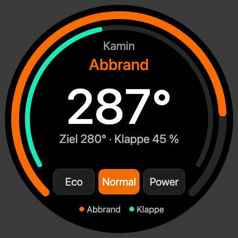
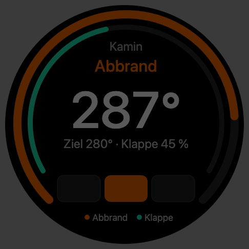
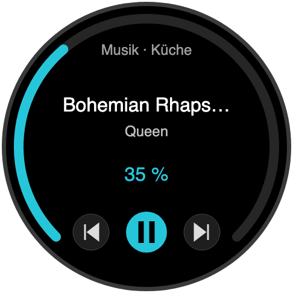
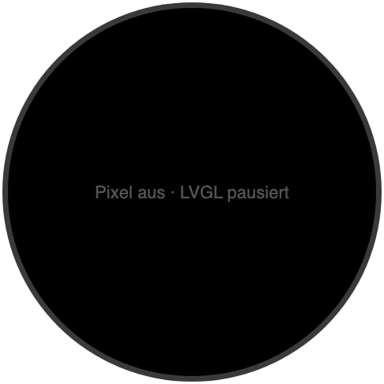

# Wanddisplay mit Drehknopf

Ein rundes Display mit Drehring, das die wichtigsten Werte des Kamins dort zeigt, wo man sie braucht: an der Wand neben dem Ofen. Die Firmware ist eine ESPHome-Konfiguration mit LVGL. Sie liest alles aus Home Assistant und braucht die App nicht zwingend.

Der Kamin ist der Ausgangspunkt, aber nicht die Grenze. Die Anzeige besteht aus Seiten, und jede Seite zeigt beliebige Entitäten aus Home Assistant. Als Beispiel liegt eine Musik-Seite bei, die Lautstärke und Wiedergabe des gerade laufenden Players steuert. Genauso lassen sich Seiten für Heizung, Licht, Wetter oder alles andere ergänzen.

**Stand:** Die Konfiguration kompiliert mit ESPHome 2026.10. Auf der Hardware ist sie noch nicht getestet.

| Kamin | Kamin gedimmt | Musik | Aus |
| --- | --- | --- | --- |
|  |  |  |  |

Die Bilder sind Wireframes mit Beispielwerten, keine Fotos vom Gerät.

## Hardware

[VIEWE UEDX46460015-MD50E](https://www.aliexpress.com/item/1005008363683358.html): 1,5" rundes AMOLED mit 466 × 466 Pixeln (CO5300 über QSPI), Touch (CST816), Drehring mit Taster und ESP32-S3 mit 16 MB Flash und 8 MB PSRAM. Versorgung mit 5 V, Verbindung nur über WLAN. Die Pinbelegung stammt aus [STB3/esphome-Viewe_UEDX4646](https://github.com/STB3/esphome-Viewe_UEDX4646).

## Bedienung

- Kurz drücken: Kamin ↔ Musik
- Lang drücken (> 0,8 s) auf der Musik-Seite: nächste Zone
- Drehen: auf der Musik-Seite Lautstärke ±2 %, auf der Kamin-Seite frei für weitere Ansichten
- Touch: auf der Kamin-Seite Eco, Normal, Power; auf der Musik-Seite Zurück, Play/Pause, Weiter
- Die erste Berührung im dunklen oder gedimmten Zustand weckt nur und löst nichts aus

## Einbrennschutz

AMOLED-Pixel altern, wenn lange dasselbe Bild steht. Nach einer einstellbaren Zeit ohne Bedienung geht das Display deshalb aus. Brennt das Feuer, bleibt die Kamin-Seite gedimmt stehen und verschiebt sich alle zwei Minuten um ein paar Pixel. Timeout, Helligkeiten und „Anzeige bei Feuer“ lassen sich in Home Assistant am Gerät einstellen.

## Dateien

| Datei | Zweck |
| --- | --- |
| `kamin-drehknopf.yaml` | ESPHome-Konfiguration |
| `ha/helfer.yaml` | Zonen-Auswahl und Template-Sensoren für die Musik-Seite |
| `ha/automation_zone_folgt_der_wiedergabe.yaml` | stellt die Zone auf den zuletzt gestarteten Player |
| `ha/script_drehknopf_medien.yaml` | nimmt Play/Pause, Weiter, Zurück und Lautstärke vom Knopf entgegen |
| `docs/wireframes.html` | Wireframes zum Öffnen im Browser |

Die Dateien unter `ha/` sind Exporte einer Beispielanlage. Die Helfer legst du in Home Assistant unter Einstellungen → Geräte & Dienste → Helfer an, Automation und Skript über den YAML-Editor.

## Anpassen

Alle Entitäten stehen oben in `kamin-drehknopf.yaml` unter `substitutions`. Trage dort deine eigenen ein:

- `e_t_abgas`: der Sensor mit der Abgastemperatur in °C
- `e_phase`: die aktuelle Phase, zum Beispiel `sensor.kamin_app_n_phase` aus der App
- `e_t_ziel`, `e_klappe_ist`, `e_feuer`, `e_modus`: Zieltemperatur, Klappenstellung, „Feuer aktiv“ und die Auswahl des Leistungsmodus (ein `input_select` mit Eco, Normal und Power)
- Musik: Die Zonen in `ha/helfer.yaml` und in der Automation zeigen auf die Player der Beispielanlage. Ersetze sie durch deine eigenen.

## Inbetriebnahme

1. `kamin-drehknopf.yaml` in den ESPHome Device Builder übernehmen. `secrets.yaml` braucht `wifi_ssid`, `wifi_password`, `wifi_ap_password` und `api_password` (32-Byte-Schlüssel, base64).
2. In Home Assistant bei der ESPHome-Integration für dieses Gerät „Gerät darf Home-Assistant-Aktionen ausführen“ einschalten. Sonst funktionieren Leistungsmodus und Musiksteuerung nicht.
3. Auf der Hardware prüfen: Bildversatz (`offset_width`), Drehrichtung, Ausrichtung des Touch und Helligkeit.
